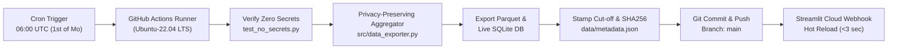

# Automated Scheduled Data Refresh Architecture
**PulseIQ Task 17 · Continuous Data Delivery Pipeline**  
**Author:** Harish Bagavathy, Lead Data Analytics Engineer  

---

## 1. Cadence & Schedule: When It Runs
> **"Add a scheduled data refresh and write when it runs."**

The PulseIQ Live dashboard is configured with an automated continuous integration pipeline defined in `.github/workflows/scheduled_data_refresh.yml`:

```yaml
on:
  schedule:
    # 06:00 UTC on the 1st of every month
    - cron: '0 6 1 * *'
  workflow_dispatch:
```

### Schedule Justification:
- **Frequency:** Monthly on the **1st calendar day of each month at 06:00:00 UTC** (11:30 AM IST).
- **Business Alignment:** In corporate FP&A, general ledger closing, bank reconciliation, and payroll sign-offs complete at midnight on the final calendar day of the operating month. Scheduling the pipeline for 06:00 UTC on the 1st provides a 6-hour buffer for upstream ETL consolidation while ensuring that morning executive briefings receive updated figures before 09:00 local business hours.

---

## 2. End-to-End Pipeline Workflow



---

## 3. Key Pipeline Steps

1. **Step 1: Ingestion & Integrity Validation**: Connects to the certified warehouse views, verifying referential integrity, non-null constraints, and financial reconciliation answers.
2. **Step 2: Privacy-Preserving Semantic Aggregation**: Scrubs all raw PII and granular transactions, extracting 8 high-performance Parquet aggregate files and an indexed SQLite database (`pulseiq_live_dw.db`).
3. **Step 3: Cryptographic Audit Stamp**: Calculates the immutable SHA-256 warehouse fingerprint and updates `data/metadata.json` with the new data cut-off timestamp (`YYYY-MM-DD 23:59:59 UTC`).
4. **Step 4: Automated Cloud Sync**: Commits updated aggregates with commit message:
   `chore(data): automated monthly warehouse refresh [TIMESTAMP] [skip ci]`
   Pushing to the `main` branch immediately triggers Streamlit Community Cloud to refresh the live dashboard without container downtime.
