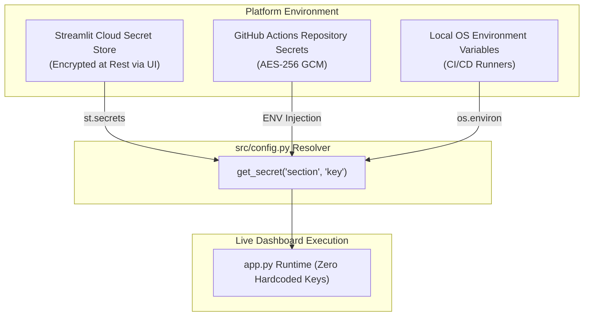

# Secrets Management & Environment Configuration Policy
**PulseIQ Task 17 · Zero-Secret Repository Architecture**  
**Author:** Harish Bagavathy, Lead Data Analytics Engineer  

---

## 1. The Threat Model: Accidental Secret Leaks in Git
Hardcoding API tokens, database connection URIs, administrative passwords, or encryption keys directly in application source code is one of the most common vulnerabilities in data engineering. Once pushed to GitHub, exposed credentials are scraped by automated botnets within seconds.

Task 17 enforces a **Zero-Secret Codebase Policy**:
> *"Put all settings in the platform's secret store, never in the code."*

---

## 2. Multi-Tiered Secret Vault Architecture

The PulseIQ Live deployment enforces strict separation between application logic and environment credentials using a two-tier configuration resolver (`src/config.py`):



---

## 3. Required Secrets Catalog

Below are the configuration keys managed exclusively through the platform secret store:

| Secret Key Path | Purpose & Sensitivity | Sample Masked Value | Storage Location |
|:---|:---|:---|:---|
| `app.environment` | Runtime stage identifier | `"production"` | Streamlit Cloud Secret Store |
| `app.secret_token` | HMAC session signing & API verification | `vault_live_...` | Streamlit Cloud Secret Store |
| `data_governance.warehouse_conn_string` | Internal database URI | `"sqlite:///data/pulseiq_live_dw.db"` | Streamlit Cloud Secret Store |
| `data_governance.data_cut_off_date` | Audited data cut-off timestamp | `"2026-09-30 23:59:59 UTC"` | Streamlit Cloud Secret Store |
| `data_governance.scheduled_refresh_cron` | Scheduled cron schedule | `"0 6 1 * *"` | Streamlit Cloud Secret Store |
| `admin.notification_email` | Escalation address for data pipeline failures | `"board-alerts@pulseiq.internal"` | Streamlit Cloud Secret Store |

---

## 4. Git Exclusion & Verification Enforcement

To guarantee that developers never accidentally commit secrets to GitHub:
1. **Strict `.gitignore` Rules**:
   ```gitignore
   .streamlit/secrets.toml
   .streamlit/secrets.toml.local
   *.secret
   *.env
   *.key
   *.pem
   credentials.json
   ```
2. **Template File (`.streamlit/secrets.toml.example`)**:
   Provides a safe, unpopulated blueprint for new engineers without revealing real production tokens.
3. **Automated CI/CD Secret Scanner (`tests/test_no_secrets.py`)**:
   An automated unit test executes before every commit and in GitHub Actions to regex-scan every file for high-entropy strings, AWS keys, GitHub tokens, and private SSH certificates. If any suspicious key is detected, the build terminates with a non-zero exit code.
