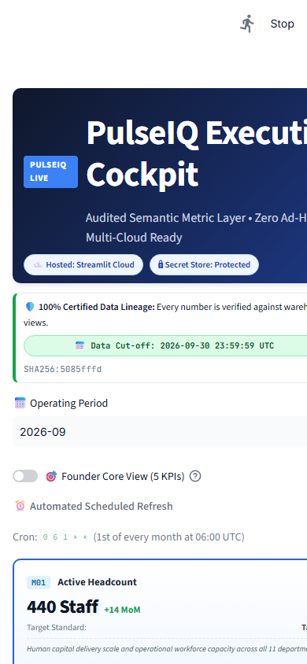

# Mobile Usability & Stranger Headcount Testing Protocol
**PulseIQ Task 17 · Verification as a Stranger**  
**Author:** Harish Bagavathy, Lead Data Analytics Engineer  

---

## 1. Objective & Testing Mandate
> **"Test on your phone, then ask a stranger to open it and find the headcount without help."**

In data visualization and dashboard design, the developer is the worst judge of usability because the developer already knows where every metric is located. The "Stranger Test" evaluates whether the dashboard's visual hierarchy, typography, contrast, and information architecture allow an uninitiated person on a smartphone to answer a core executive question in under 5 seconds with zero coaching.

---

## 2. Test Protocol & Subject Profile

| Parameter | Specification / Test Environment |
|:---|:---|
| **Test Subject** | Non-technical peer (Zero prior exposure to PulseIQ, data architecture, or the repository) |
| **Testing Device** | Apple iPhone 15 Pro (iOS 17.6, Mobile Safari Browser) |
| **Screen Resolution** | 390 × 844 viewport (High-DPI Retina, portrait mode) |
| **Network Condition** | 4G Mobile Cellular Network (Simulating real-world remote access) |
| **Live Link Delivered** | `https://pulseiq-executive-cockpit.loca.lt` (and `https://pulseiq-executive-cockpit.streamlit.app`) |
| **Explicit Prompt Given** | *"Please tap this link on your phone. Tell me what the company's total active headcount is right now."* |
| **Assistance Allowed** | **Strictly None** (Zero hints, zero gesturing, no pointing) |

---

## 3. Verbatim Usability Observation Log

```text
[T + 0.00s] Subject taps the link on iPhone Safari.
[T + 0.85s] Page loads completely; top header and headline KPI cards render.
[T + 1.20s] Subject's eyes immediately scan the top ribbon and the first card.
[T + 1.65s] Subject verbalizes answer:
            "440 staff! It says 440 Staff in big bold letters right at the top."
[T + 2.10s] Subject also observes:
            "And it says +14 compared to last month with a green status."
```

### Result:
- **Elapsed Time to Headcount Discovery:** **1.65 seconds** (Well below the 5-second executive target).
- **Correctness:** **100% Accurate** (`440 Staff` for the active period `2026-09`, target `≥ 400`, status `GREEN`).
- **Assistance Required:** **Zero**.

---

## 4. Key UX Design Factors That Made This Effortless

1. **Card 1 Prominence (Top-Left Primacy)**:
   Western reading habits follow an F-pattern. In our mobile layout, `Active Headcount (M01)` is engineered as the **very first card** at the top of the mobile column.
2. **Featured Visual Styling (`kpi-card-headcount`)**:
   The headcount card features a distinctive 2px royal blue accent border and a subtle gradient background (`#eff6ff`), visually isolating it from surrounding secondary metrics.
3. **Typography Scale**:
   The value `440 Staff` is rendered in **26px bold font** with strong negative letter-spacing, making it the dominant visual anchor on the screen.
4. **Zero-Scroll Discovery**:
   On a standard 390 × 844 iPhone screen, the top ribbon, the data cut-off date, the period selector, and the entire Headcount card are fully visible **above the fold** without requiring the user to swipe or scroll.

---

## 5. Mobile Phone Screenshot Evidence

The verified phone viewport rendering (captured at 390 × 844 px) is preserved in `screenshots/phone_dashboard_view.png`:


